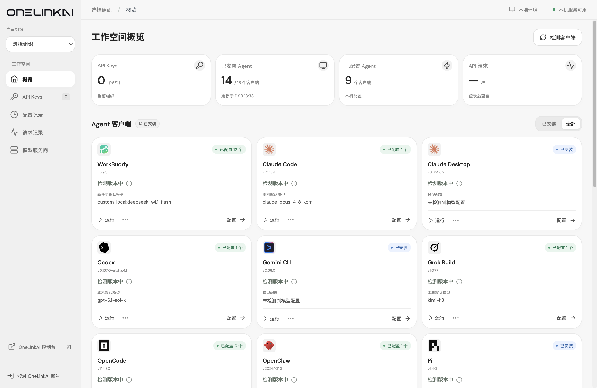

# One Key

**一个工作台，管理 AI 编程工具与模型配置。**

One Key 将分散在不同工具里的安装、服务商、模型和配置管理集中到桌面应用中。无论使用 Claude Code、Codex、Gemini CLI，还是 VS Code、Zed 等编辑器，都可以通过统一的界面连接模型服务，减少反复查找配置文件、填写地址与切换模型的操作。

支持自带 API Key（BYOK），也可以登录 OneLinkAI 平台使用已有的模型服务。



## 能做什么

- **管理 AI 工具**：检测安装状态与版本，按工具和系统能力提供安装、更新、启动与卸载入口。
- **统一服务商与模型**：维护多个服务商的接口地址、协议、API Key 和模型列表，集中管理模型名称、上下文窗口与输出限制。
- **一键配置**：按目标工具的原生格式生成配置，针对支持的工具设置推理强度、子代理模型、压缩阈值等参数。
- **预览、备份与恢复**：写入前查看变更，自动保存备份；多文件写入失败回滚，恢复前检查配置是否被其他工具修改。
- **查看本机配置**：搜索、刷新和复制脱敏后的配置内容，支持 JSON、JSONC、JSON5、TOML 与 YAML。
- **连接平台工作台**：登录 OneLinkAI 后查看组织、API Keys、模型与请求记录；本地 BYOK 管理可独立使用。

## 支持的工具

| 类型 | 工具 |
| --- | --- |
| CLI / Agent | Claude Code、Codex、Gemini CLI、Grok Build、OpenCode、OpenClaw、Pi、MiniMax Code、Hermes、DeepSeek Harness CLI |
| 桌面应用 / 编辑器 | Claude Desktop、DeepSeek Harness Desktop、VS Code、Zed、ZCode、WorkBuddy |

各工具支持的协议、参数、安装和更新方式有所不同，界面会展示实际能力及限制。部分编辑器需要在应用内保存 API Key 或选择模型。详见 [Agent 参考](product-docs/pages/reference/agents/index.md)。

## 技术栈

| 层级 | 技术与职责 |
| --- | --- |
| 桌面运行时 | Electron：窗口、托盘、本机文件操作和系统进程管理 |
| 界面 | React 19、Vite 6、CSS、Lucide React 图标 |
| 本机服务 | Node.js、Electron IPC、按工具划分的配置适配器 |
| 配置解析 | jsonc-parser、JSON5、YAML、@iarna/toml |
| 本地存储 | AES-256-GCM 加密保存平台会话与 BYOK 资料 |
| 软件更新 | electron-updater、完整安装包校验与确认安装 |
| 构建与测试 | electron-builder、Node.js Test Runner、Electron 流程验证 |
| 产品文档 | VitePress |

渲染进程通过受限的 preload 接口调用主进程，本机配置、凭据与进程操作在主进程执行。界面启用上下文隔离与沙箱，不直接开放 Node.js 能力。

## 本地开发

准备 Node.js 与 npm，然后执行：

```sh
git clone https://github.com/1onelinkai/onekey.git
cd onekey
npm ci
npm run desktop:dev
```

仅预览网页界面：

```sh
npm run dev
```

网页预览默认使用 5174 端口；本机检测、安装和配置能力需通过 Electron 使用。桌面应用关闭窗口后保留在系统托盘，可从托盘菜单完整退出。

## 常用命令

```sh
npm test                    # 单元与集成测试
npm run build               # 编译前端与本机模块
npm run desktop:check       # 桌面页面启动检查
npm run desktop:test-flow   # 配置预览、写入和恢复流程
npm run desktop:pack        # 生成应用目录
npm run desktop:dist        # 按平台配置生成安装包
```

构建本机模块需要对应平台的开发工具；签名发行还需配置构建者自己的证书。平台适配与实机验证范围见 [安装验收记录](docs/installation-validation.md)，发行细节见 [分发文档](docs/macos-distribution.md)，更新服务见 [软件更新 API](docs/software-updates.md)。

## 项目结构

```text
electron/       主进程、IPC、工具适配器、安装更新与测试
src/            React 工作台、交互组件及工具能力定义
build/          图标、构建权限及运行时配置
scripts/        开发、打包与验证脚本
product-docs/   用户说明与原理文档站
docs/           接口契约、工程记录与项目截图
官网/           独立产品官网
```

## 文档与官网

```sh
npm --prefix product-docs ci
npm run docs:dev             # 文档站，默认 5175 端口
npm run docs:check
npm run docs:build

npm --prefix 官网 ci
npm run website:dev          # 独立官网，默认 5173 端口
npm run website:build
```

完整说明从 [产品文档首页](product-docs/pages/index.md) 开始。

## 数据说明

平台会话与 BYOK 资料以本地加密文件保存，当前生产路径不读取系统钥匙串。密钥文件与密文位于同一用户目录，不能防御已经能读取二者的程序。目标工具的配置与恢复备份可能含明文凭据，请勿公开分享。

配置写入成功与模型连接成功分别展示；连接测试会真实调用所选服务。退出平台登录不会撤销已写入工具的配置。

部分工具的配置格式参考 [Magpie](https://github.com/yetone/magpie)，未复制其源代码。
